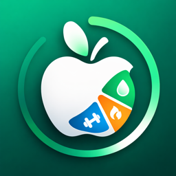
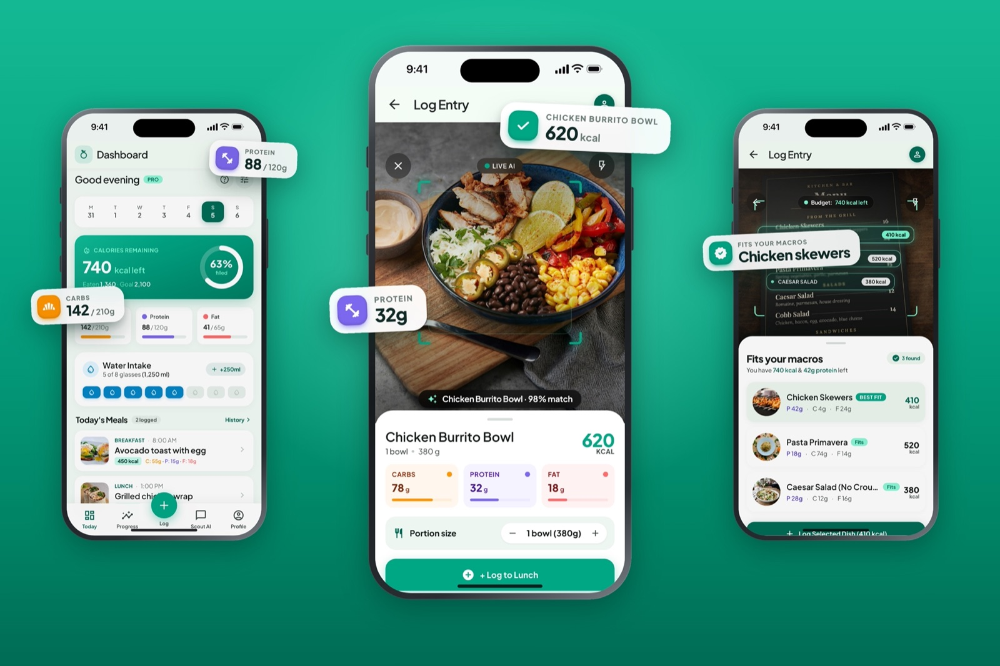
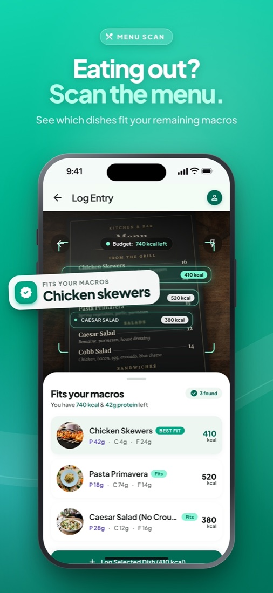
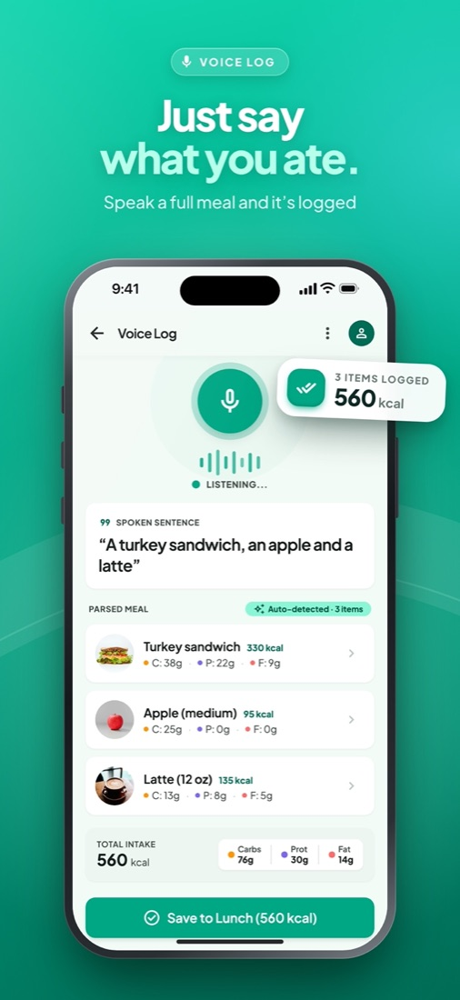
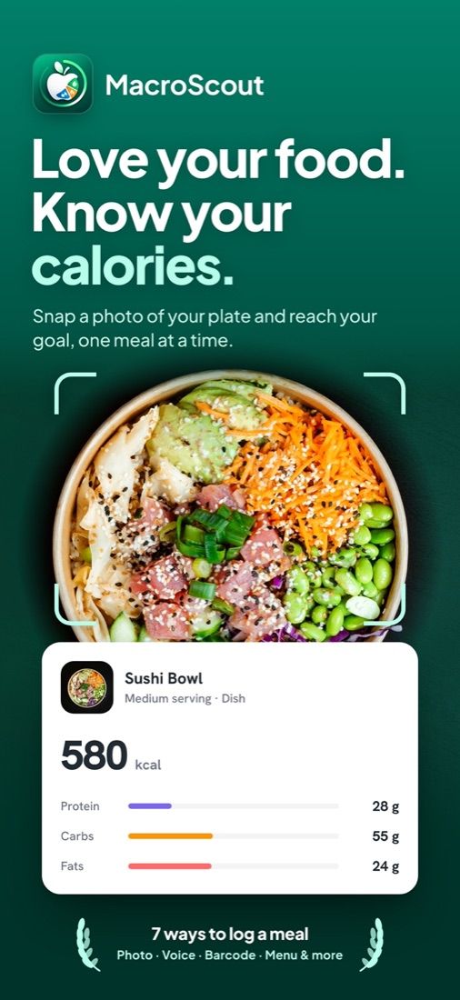

# MacroScout: AI calorie tracker and restaurant menu scanner

MacroScout is an AI calorie and macro tracker for people who eat out. Snap your plate, or scan a restaurant menu and see which dishes fit what you have left today.

[Download on the App Store](https://apps.apple.com/app/apple-store/id6760803463?pt=128676461&ct=github-readme&mt=8) · [Get it on Google Play](https://play.google.com/store/apps/details?id=com.javediqbal8381.calorietracker&referrer=utm_source%3Dgithub%26utm_medium%3Dreadme%26utm_campaign%3Dmacroscout) · [Website](https://health.dailyappslab.com/macroscout/)

## What it does

Take a photo of your plate, say what you ate ("two eggs and toast") or type it, and MacroScout logs calories, protein, carbs and fat. Barcode scanning, repeat meals and manual entry are there too.

The main feature is the restaurant menu scanner. Photograph a menu and MacroScout ranks the dishes by how well they fit the calories and protein you have left today, allowing for the oil and butter restaurants add.

- Photo, voice and text meal logging
- Restaurant menu scanner that ranks dishes for your day
- Barcode scanner, repeat meals and manual entry
- Calorie and macro targets for losing, gaining or keeping your weight
- Water, weight, BMI and workout tracking, with streaks
- An AI coach that suggests meals you can log with one tap
- Diet preferences: halal, vegetarian, vegan, pescatarian, no beef

| Menu scan | Voice log | Daily view |
|---|---|---|
|  |  |  |

## Price

Free to download. The free plan logs up to 10 meals a day with barcode, repeat or manual entry. Pro adds photo, voice and text AI logging (up to 10 AI logs a day) and the menu scanner. New accounts start with a short free trial of Pro. In the US, Pro is $6.99 a month or $29.99 a year; prices vary by country.

Works on iPhone, iPad, Mac with Apple silicon, and Android.

## Free tools from the same team

- [Protein Finder](https://health.dailyappslab.com/macroscout/protein-finder/): fast-food items with at least your protein and under your calorie limit, at McDonald's, Burger King, Subway, Starbucks and Chipotle. It runs in the browser without the app.
- [fast-food-protein-us](https://github.com/dailyappslab/fast-food-protein-us): the 259-item dataset behind the finder (CSV, CC BY 4.0).
- Chain guides: [McDonald's](https://health.dailyappslab.com/macroscout/mcdonalds-high-protein/), [Burger King](https://health.dailyappslab.com/macroscout/burger-king-high-protein/), [Subway](https://health.dailyappslab.com/macroscout/subway-high-protein/), [Starbucks](https://health.dailyappslab.com/macroscout/starbucks-protein-drinks/) and [high-protein fast food under 500 calories](https://health.dailyappslab.com/macroscout/high-protein-fast-food/).
- [How to count calories when eating out](https://health.dailyappslab.com/macroscout/how-to-count-calories-when-eating-out/).

## About this repository

The app's source code is private. This repository holds the app's public page, screenshots and links. Questions and bug reports are welcome as [issues](https://github.com/dailyappslab/macroscout/issues).

Made by [Javed Iqbal](https://github.com/javediqbal-byte) at [Daily Apps Lab](https://dailyappslab.com/). MacroScout gives general nutrition estimates, not medical advice.
